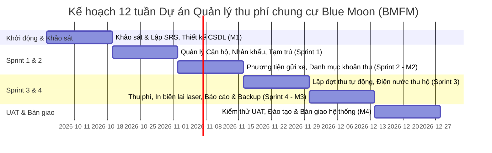

# KẾ HOẠCH PHÁT TRIỂN PHẦN MỀM QUẢN LÝ THU PHÍ CHUNG CƯ BLUE MOON (BMFM)
**Môn học:** Kỹ thuật phần mềm (KTPM 2026)  
**Đơn vị thực hiện:** Nhóm 12  
**Mô hình phát triển:** Agile / Scrum (4 Sprints, chu kỳ 2 tuần/Sprint, tổng thời gian 12 tuần)

---

## 1. THÀNH VIÊN VÀ PHÂN CÔNG VAI TRÒ DỰ ÁN

| STT | Họ và tên | MSSV | Vai trò trong dự án | Nhiệm vụ chính |
| :---: | :--- | :---: | :--- | :--- |
| 1 | **Vũ Quang Nhật** | 20235800 | Scrum Master / Backend Lead | Điều phối Sprint, thiết kế CSDL, phát triển REST API |
| 2 | **Trịnh Ngọc Quý** | 20235819 | Frontend Lead | Thiết kế giao diện Web, biểu đồ, tương tác SPA |
| 3 | **Phạm Xuân Thịnh** | 20235842 | Business Analyst (BA) | Khảo sát nghiệp vụ, đặc tả SRS, tài liệu hướng dẫn |
| 4 | **Ngô Công Tuấn Anh** | 20235645 | Fullstack Dev / Logic Engine | Phát triển module tính toán phí tự động, CR-003 |
| 5 | **Hàn Kim Trường** | 20235855 | QA / Tester / DevOps | Viết Test cases, kiểm thử UAT, đóng gói và tài liệu |

---

## 2. LÝ DO LỰA CHỌN MÔ HÌNH AGILE / SCRUM

Chung cư Blue Moon có quy mô căn hộ lớn với mật độ dân cư cao. Trước đây công tác quản lý hoàn toàn dựa vào sổ tay và bảng tính Excel thủ công, dẫn đến sai sót tính phí, thất thoát dữ liệu gửi xe và khó khăn khi đối soát công nợ.

Nhóm lựa chọn mô hình **Agile/Scrum** với chu kỳ 2 tuần/Sprint vì các lý do chiến lược:
1. **Trải nghiệm sản phẩm sớm:** Ban Quản Trị (đóng vai trò Product Owner) được trải nghiệm phần mềm qua từng Sprint Demo (tuần 4, 6, 8, 10), phát hiện sớm sai lệch tính toán.
2. **Thích ứng linh hoạt với thay đổi:** Các quy định về mức thu, đơn giá dịch vụ và các kịch bản ngoại lệ (như hộ chuyển đến giữa tháng theo Change Request CR-003) có thể được bổ sung vào Sprint tiếp theo mà không phá vỡ cấu trúc hệ thống.
3. **Kiểm soát chất lượng liên tục:** Mỗi tính năng đều trải qua quy trình kiểm thử và nghiệm thu nghiêm ngặt trước khi được đánh dấu hoàn thành (Definition of Done).

---

## 3. KẾ HOẠCH TỔNG THỂ 12 TUẦN (MASTER PLAN)

### Chi tiết các giai đoạn:

| Giai đoạn | Thời gian | Hạng mục công việc chính | Kết quả bàn giao (Deliverables) |
| :--- | :---: | :--- | :--- |
| **Khởi động & Khảo sát** | Tuần 1 – Tuần 2 | Khảo sát hiện trạng Excel, chốt tài liệu SRS, thiết kế ERD 9 bảng, thiết kế Prototype UI. | Tài liệu SRS, File SQL CSDL, Prototype Web UI. |
| **Sprint 1** | Tuần 3 – Tuần 4 | Xây dựng Module Quản lý Căn hộ / Hộ khẩu (`UC02`), Quản lý Nhân khẩu cư dân (`UC03`), Tạm trú/tạm vắng (`UC04`). | Hoàn thiện chức năng quản lý cư dân và căn hộ. |
| **Sprint 2** | Tuần 5 – Tuần 6 | Quản lý Phương tiện gửi xe (`UC05`), Cấu hình danh mục khoản thu và đơn giá động (`UC06`). | Bản demo M2: Quản lý đầy đủ cư dân, xe và bảng phí. |
| **Sprint 3** | Tuần 7 – Tuần 8 | Module Lập đợt thu phí tháng tự động (`UC07`), tính theo m² và số xe, xử lý Change Request CR-003 (tính số ngày thực tế), Module Điện nước thu hộ (`UC08`). | Hệ thống sinh dữ liệu công nợ tự động cho 100% căn hộ. |
| **Sprint 4** | Tuần 9 – Tuần 10 | Ghi nhận thu phí, cập nhật trạng thái nợ, in biên lai laser chuẩn (`UC09`), Báo cáo thống kê Dashboard (`UC10`), Phân quyền (`UC11`), Backup/Restore (`UC12`). | Bản Beta M3: Hoàn chỉnh 12 use-case của hệ thống. |
| **UAT & Bàn giao** | Tuần 11 – Tuần 12 | Kiểm thử chấp nhận người dùng (UAT), chuyển đổi dữ liệu từ Excel cũ, đào tạo kế toán, bàn giao mã nguồn. | Hệ thống chính thức golive, tài liệu User Manual. |

---

## 4. CÁC MỐC KIỂM SOÁT TIẾN ĐỘ CHÍNH (MILESTONES)

* **Mốc M1 (Hạn: 18/10/2026):** Hoàn thiện tài liệu SRS, tài liệu thiết kế CSDL (ERD 9 bảng), đặc tả Use-case và Prototype giao diện được Ban Quản Trị duyệt.
* **Mốc M2 (Hạn: 15/11/2026):** Hoàn thành Sprint 1 & 2: Bản demo chạy thử phân hệ Quản lý căn hộ, cư dân, xe và danh mục khoản thu.
* **Mốc M3 (Hạn: 13/12/2026):** Hoàn thành Sprint 3 & 4: Bản Beta tích hợp hoàn chỉnh tính năng sinh hóa đơn, thu phí, in biên lai laser và trích xuất báo cáo.
* **Mốc M4 (Hạn: 27/12/2026):** Nghiệm thu UAT toàn diện, bàn giao mã nguồn và tài liệu hướng dẫn sử dụng, đưa hệ thống vào vận hành thực tế.

---

## 5. TIÊU CHUẨN HOÀN THÀNH CÔNG VIỆC (DEFINITION OF DONE - DoD)

Mỗi User Story / Task chỉ được chuyển trạng thái sang **Done** khi hoàn thành quy trình 5 bước:
1. **Assignment (Nhận việc):** Chuyển task sang "In Progress", hiểu rõ tiêu chí chấp nhận (Acceptance Criteria).
2. **Development (Lập trình):** Viết code trên nhánh feature riêng, viết chú thích đầy đủ bằng tiếng Việt, viết Unit Test với độ bao phủ (coverage) ≥ 70%.
3. **Code Review (PR):** Tạo Pull Request trên GitHub, có ít nhất 1 thành viên review và phê duyệt.
4. **Testing (QA/Kiểm thử):** Tester kiểm thử trên môi trường chạy thử theo các kịch bản test case.
5. **Done (Hoàn thành):** Merge mã nguồn vào nhánh develop, đóng ticket trên bảng điều phối.

---

## 6. QUẢN LÝ THAY ĐỔI (CHANGE REQUEST CR-003)

* **Mã yêu cầu:** `CR-003` (Ngày phê duyệt: 12/11/2026)
* **Người đề xuất:** Trưởng Ban quản trị chung cư Blue Moon (Product Owner).
* **Nội dung:** Đối với các căn hộ nhận bàn giao hoặc chuyển đến sinh sống giữa tháng, hệ thống cần tính toán tiền phí dịch vụ và quản lý theo đúng tỷ lệ số ngày ở thực tế thay vì thu trọn vẹn cả tháng.
* **Giải pháp kỹ thuật:** Bổ sung trường `ngay_chuyen_den` trong bảng `HO_KHAU`. Trong hàm tính toán của `UC07`, nếu ngày chuyển đến thuộc tháng của kỳ thu, tính hệ số:
  $$\text{Tỷ lệ ngày} = \frac{30 - \text{Ngày chuyển đến} + 1}{30}$$
  Phí dịch vụ và quản lý được nhân trực tiếp với tỷ lệ này trước khi lưu vào `CHI_TIET_THU`.
* **Đánh giá:** Đã được tích hợp và kiểm thử thành công trong mã nguồn của hệ thống.
